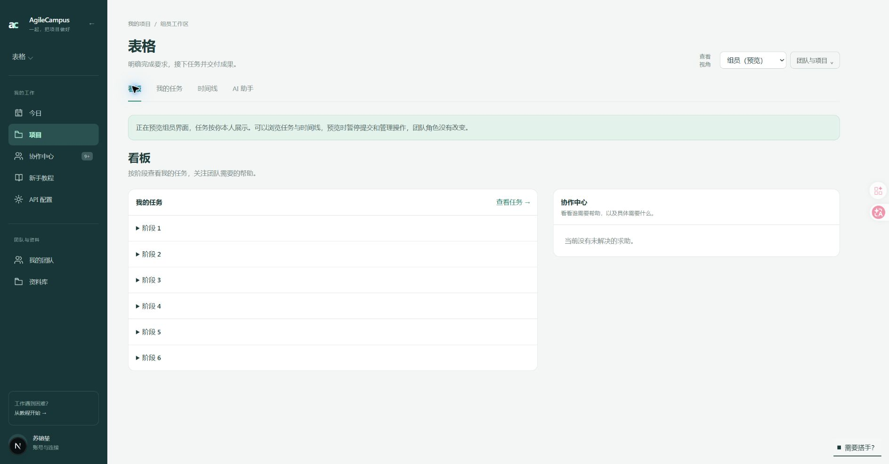

# 三角色项目工作区调整

2026-10-11，按本轮四张参考截图与用户要求修改本地网站。

| 角色 | 项目入口 |
| --- | --- |
| 组员 | 看板、我的任务、时间线、AI 助手 |
| 组长 | 公共入口，以及原项目推进台、分工、成果与记录 |
| 老师 | 审核台、成果验收（包含阶段集成审核）、时间线、成果与记录 |

看板左侧按阶段列出本人任务，所有阶段默认折叠；点击任务进入我的任务详情，并展开对应阶段。右侧协作中心显示求助人、需要的帮助和任务入口。我的任务也按阶段折叠，取回完整任务集合后按任务顺序展示，不会遗漏超过一页的任务。

时间线上方保留阶段进度卡，只统计当前执行或集成阶段的叶子任务。下方直接展示原连续任务树，删除旧阶段任务列表和阶段/时间线分类栏。完成节点为绿色，点击任务在当前页打开原生模态弹窗，包含目标、完成标准、成果说明、验收意见和交付分支；有执行权限的人可在弹窗登记分支。规划草案仍由组长通过推进台进入。

AI 助手直接使用项目对话页面，保留任务、会话及审批深链接。组员导航隐藏成果与记录，直接访问成果档案、复盘或活动页也返回看板。预览可以浏览、折叠和查看任务树，提交及管理操作仍暂停。

组长在分工页选择任务后使用“下派任务 / 调整分工”，选择实际组员并填写交接要求。该表单服务端限制只有组长可以下派，保存后沿用原契约版本与认领重置逻辑。

老师成果验收只列出已完成任务，任务复核与阶段集成审核位于同页。复核通过或需修改会保存意见和独立事件；复核不重复计算首次验收贡献、不重新触发下游交接，也不会自动重开已完成任务。需修改的具体内容由老师填写反馈。未完成任务、跨项目任务、自审与非老师提交均被拒绝。阶段集成继续沿用原非提交者审核规则。

相关教程入口与目标同步调整，避免仍然指向被删除的分类栏和阶段列表。

## 验证

- 14 个相关 Vitest 文件，95 项通过：覆盖角色任务范围、阶段分组、分页、复核权限与记录、任务树、预览、导航及教程回归。
- 生产构建通过；ESLint 无错误，30 个既有警告均在本轮未修改文件；UI 文案检查通过。
- 浏览器验证了组员导航、阶段默认折叠、看板任务跳转、AI 项目对话、组长分工表单、老师仅完成任务队列，以及任务树绿色节点与模态弹窗。
- 浏览器使用已有项目与组长角色预览，只浏览和打开表单，没有保存分工、认领、提交成果、复核或集成审核。结束时恢复原老师预览与时间线页面。
- 本项目暂无求助或阶段集成提交，对应页面验证为空态；真实审核动作由测试库验证。

## 截图

[组长下派表单](leader-dispatch.png) / [老师成果与集成审核](teacher-review.png) / [时间线任务弹窗](timeline-dialog.png)
