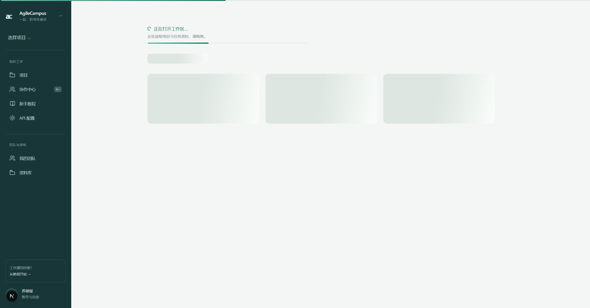

# 加载反馈

按用户要求，在适合的等待位置加入动画进度反馈。

- 页面导航使用 Next Link 的真实 pending 状态显示顶部进度条；项目切换与任务切换使用原生 React transition 状态，视角切换使用提交状态。指示器通过 portal 放在页面顶部，不改变链接、卡片尺寸，不拦截点击。
- 页面 loading 增加局部进度条与扫光骨架。任务详情、会话读取、AI 处理、任务树生成与编排、交付登记、分工保存和审核保存均复用局部加载反馈。
- 所有进度条为不确定进度动画，不显示虚构百分比，不添加请求延迟。完成、失败或停止后跟随原请求状态消失；系统选择减少动态效果时显示静态提示。
- 生产构建通过；ESLint 无错误（30 个既有警告均在未修改文件）；UI 文案检查与 diff 检查通过；4 个相关回归测试文件，48 项通过。
- 浏览器确认项目卡片及项目标签导航显示顶部进度条，并在加载完成后移除；任务选择可正常进入详情。只进行了浏览，没有提交认领、成果、审核或 AI 请求。
- 使用临时只读慢响应页面验证 loading 骨架、进度动画及完成后清理，并保存下面的截图。预览路由与模拟延迟已移除，正式功能没有增加延迟。

