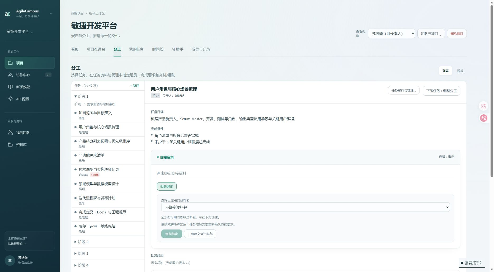
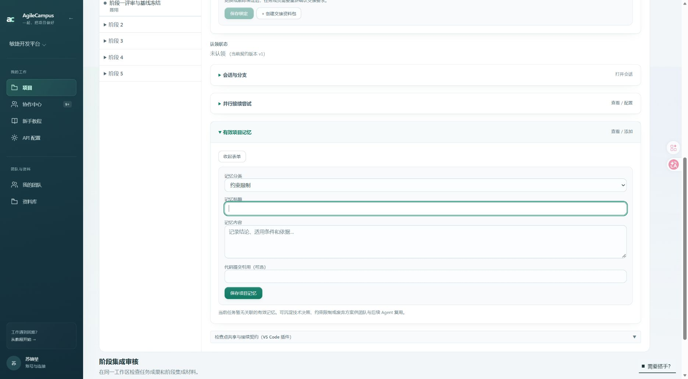

# 任务资料入口检查

## 已补齐

- 交接资料：栏目内直接绑定、更换、解除绑定；选择当前项目、当前任务可读的冻结包。没有资料包时可以就地预览来源、创建并冻结，再明确保存绑定。
- 有效项目记忆：网页添加分类、标题、内容、代码引用，自动关联当前任务，保存后刷新列表。
- 并行接续尝试、检查点：链接到个人令牌页的 VS Code 连接说明，并展示真实插件命令。本地尝试与服务端回执分别说明，不承诺自动同步本地尝试。
- 折叠标题增加操作提示，保持原有栏目位置与默认折叠。
- 交接编辑器不再要求手输资料包 UUID，空态引导到就地创建入口。

会话与分支已提供任务会话和新建入口，保留。认领、提交证据、验收和执行记录继续使用原有状态与权限控制。

## 权限与修复

新增网页操作使用真实登录身份。服务端重新核对项目成员资格和预览 cookie；具体组员、教师预览均禁止写入。资料绑定还验证冻结状态、任务与项目归属，以及私人会话读取权限。验收中、已完成任务禁止直接修改交接资料。

修复 updateTask 的显式 contextPackId=null 被旧值覆盖问题，使解除绑定实际生效。单独绑定只修改资料字段，不会清空其他交接条件，交接版本仍自动更新。

## 验证

- Vitest：task-material、task-material-actions、handoff、context-pack 共 25 项通过（独立 .env.test 测试库）。包含绑定与解除、其他要求保留、跨项目/跨任务/草稿/私人资料拒绝、预览及未登录拒绝、记忆任务关联。
- 全仓 lint：0 错误，30 条既有警告；UI 文案检查通过。
- Next.js 生产构建通过，并已更新 http://127.0.0.1:3106。
- 浏览器：哈哈哈预览显示禁用入口及只读提示；组长本人可打开绑定、创建、预览来源、项目记忆表单；插件配置链接跳到连接说明。
- 浏览器验证不创建真实资料、记忆、令牌，不修改真实任务。结束时恢复哈哈哈视角。

