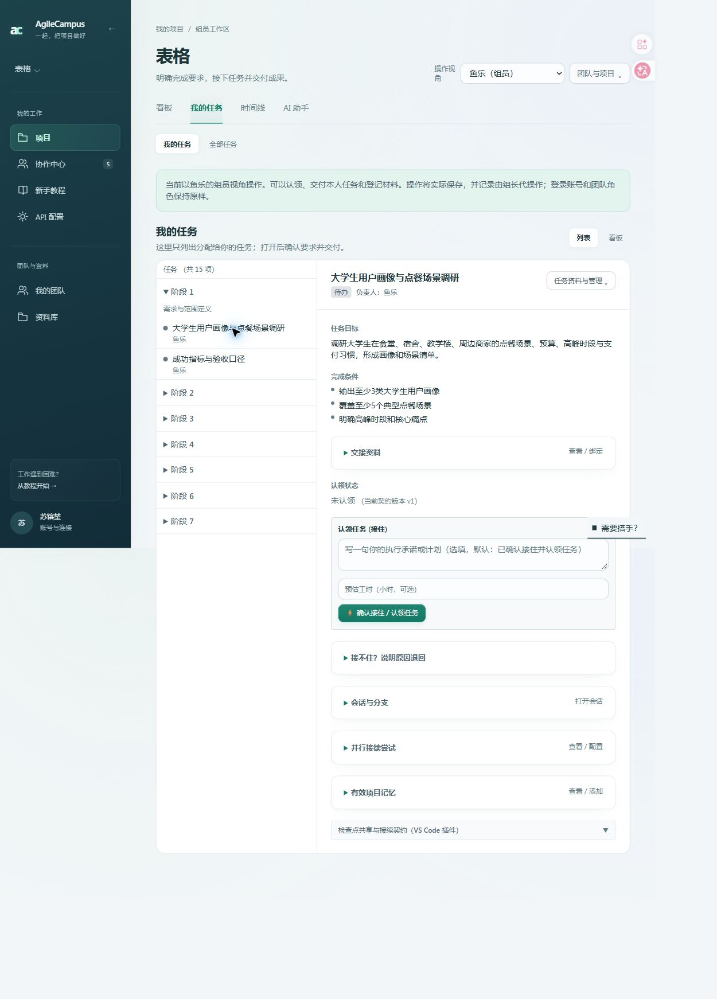
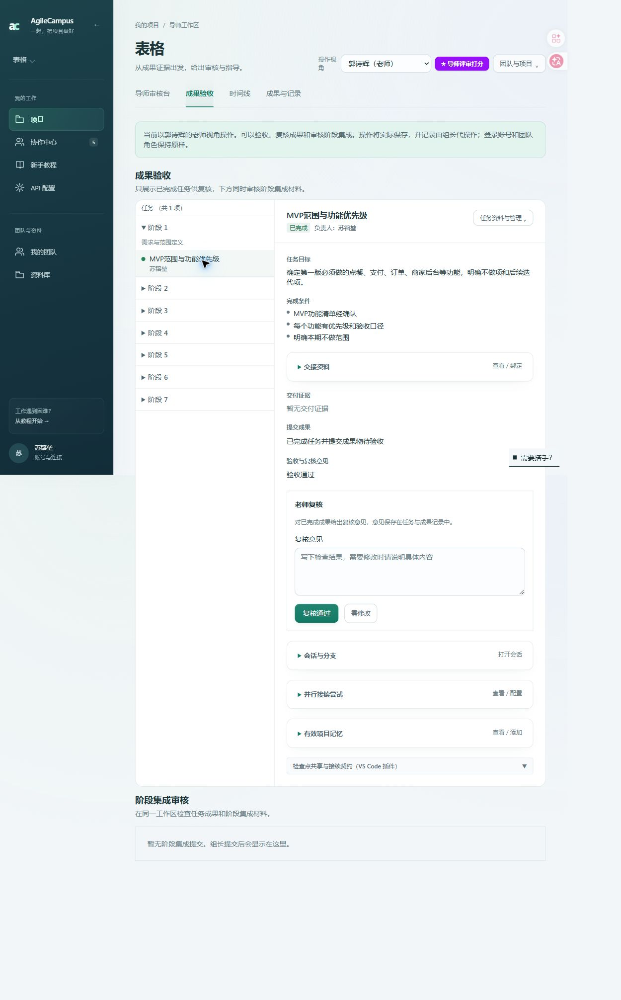

# 组长切换视角后实际操作

根据用户要求，组长选择具体组员或老师后从只读预览改为可操作。视角标签改为“操作视角”，横幅说明操作会真实保存及代操作身份。

## 已接通

- 组员：认领、退回认领、提交成果及必需证据、编辑交接要求、绑定资料、添加记忆、登记任务交付分支。
- 老师：验收、完成成果复核、阶段集成审核、导师评语。
- 任务列表/看板、时间线交付入口和 AI 助手解除原来的预览禁用；原有角色功能范围与任务状态规则继续适用。
- AI 服务配置和私人资料读取仍使用真实登录账号，未切换登录账号或写团队角色。

## 后端身份与审计

网页 action 从服务端重新读取真实组长的当前项目角色、视角 cookie、所选人类成员及其角色。组员/老师不能靠伪造 cookie 获得其他身份。跨项目任务、阶段、集成对象在执行前拒绝；已移除或角色改变的人选要求重新选择。

领域操作使用所选成员身份，确保认领不会把任务抢回组长、交付人和老师审核人正确。AsyncLocalStorage 仅在该次操作中保留代操作上下文；活动记录的 actorId 保留真实组长，payload.delegation 保留所选成员、角色与实际操作者，摘要标注“组长代…操作”。没有领域活动记录的材料/集成操作会补充审计记录。

## 验证

- 9 个相关测试文件合计 64 项通过，两批各 41 项、30 项（共同包含 7 项代操作专项）。覆盖真实 server action 认领/提交/验收/复核、交付人、阶段审核人、审计、普通成员越权、他人任务、成员移除/角色变化、跨项目拒绝及原有交接/任务树行为。
- 全仓 lint 0 错误；修复本轮新增的未使用导入，保留 30 条既有警告。UI 文案检查通过。
- 构建时发现既有 draft-planning-ai 两处读取可选 plan 的类型问题，补充明确失败断言，原测试全部通过。
- Next.js 生产构建与类型检查通过，更新至 http://127.0.0.1:3106。
- 浏览器：实际“表格”项目鱼乐视角认领按钮 enabled=true；郭诗辉视角复核按钮 enabled=true、导师评语入口可见；结束时恢复组长本人视角。
- 实际任务未因本轮 UI 验证被认领、提交或验收。写入流程在独立 .env.test 测试库验证。

