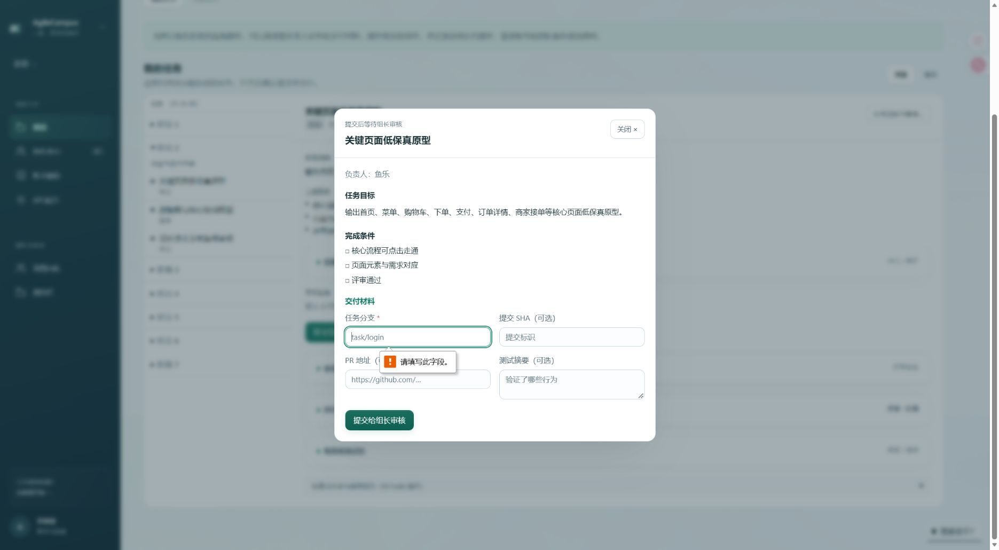
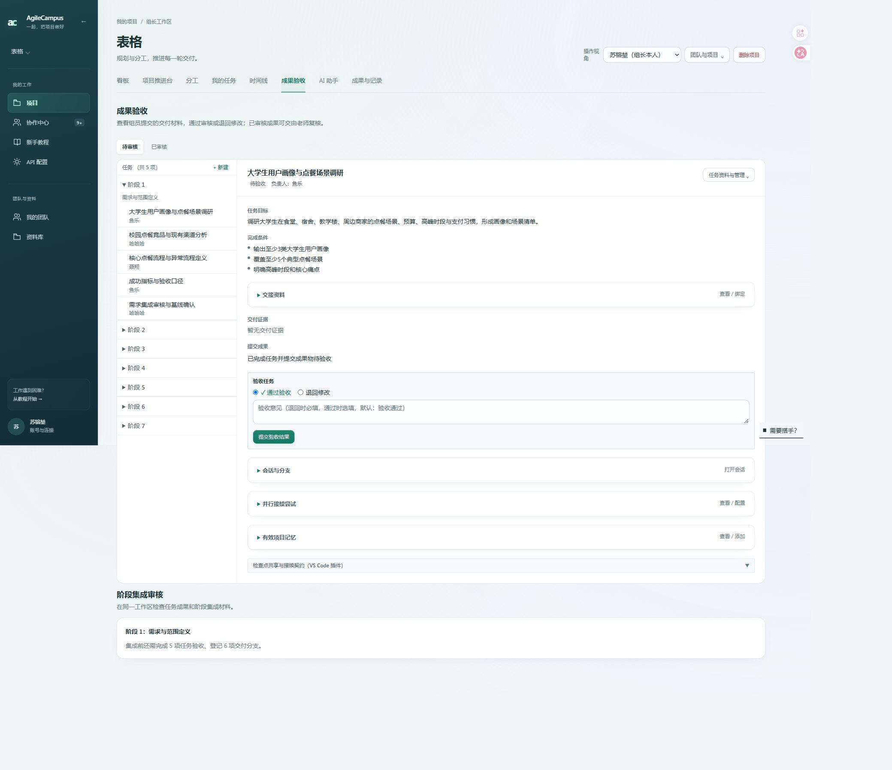
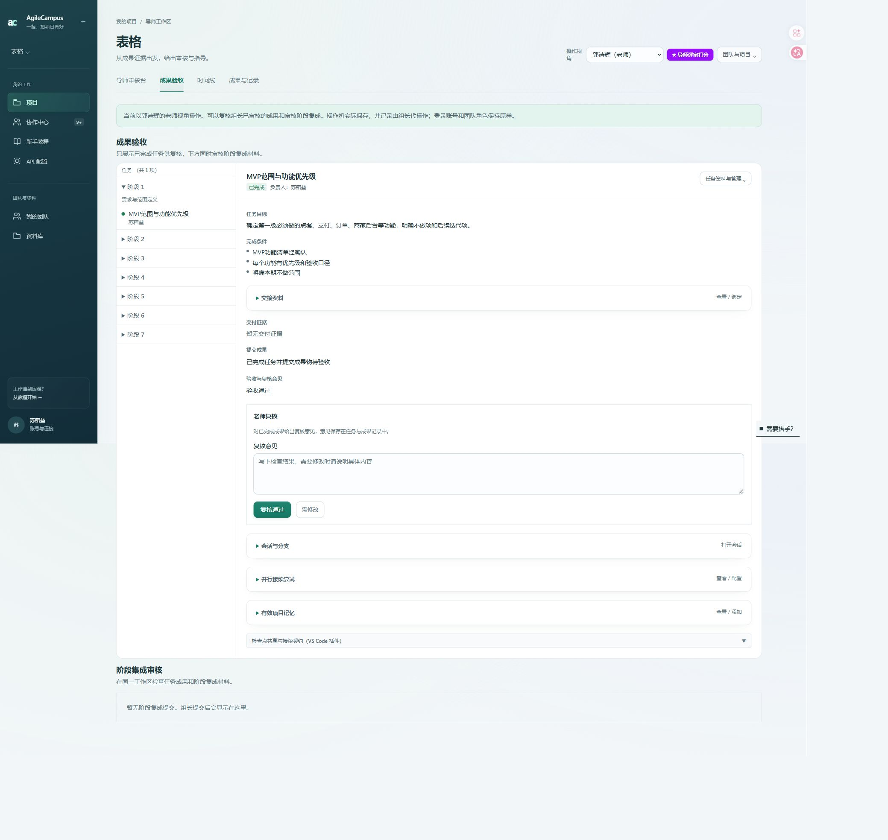

# 直接提交任务与两级成果审核

组员不再需要先确认接住任务。任务详情、任务卡和时间线详情共用提交表单：任务分支必填，SHA、PR 地址和测试摘要按用户截图保留选填，任务配置的必需交付证据仍须补齐。成功提交同时保存分支材料、证据和待审核状态；失败时全部回滚。旧窗口版本、重复提交、锁定阶段和无执行权限均拒绝。

组长新增成果验收入口，分为待审核和已审核，保留阶段集成面板；组长可通过或退回任务。老师不能初审，只能复核组长审核通过的任务，保留现有阶段集成审核功能。初审通知只发给组长。组长切换具体成员视角时继续按所选身份执行，并保留实际操作者审计。

验证使用隔离测试库，实际项目仅检查页面与空表单必填拦截，没有提交、审核或复核真实任务。

- 11 个相关测试文件共 123 项通过，另 2 个通知测试文件共 12 项通过。
- ESLint 无错误（30 条既有警告），UI 文案检查、TypeScript 与生产构建通过。
- 实际项目检查：鱼乐任务无需认领即可打开提交窗口；空分支被浏览器阻止；组长待审核队列显示 5 项已有提交，审核表单提供通过和退回；郭诗辉只看到 1 项已完成任务并可打开复核表单；最终恢复苏镕堃组长视角。

