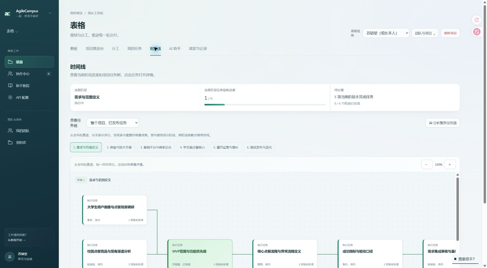

# 实际项目分工修正

用户指出实际项目的任务树仍全由苏镕堃负责。浏览器当前项目是汪汪队的“表格”（9f1b8e5b-1e54-4fa2-8d16-d12fdc40a04a）。此前已均分的是另一个“敏捷开发平台”项目，未覆盖实际项目。

## 本次结果

将“表格”的 45 个待办任务按阶段、排序轮流分配给当前团队的三位组员：

| 组员 | 待办任务 |
| --- | ---: |
| 鱼乐 | 15 |
| 哈哈哈 | 15 |
| 聂翔 | 15 |

已完成的“MVP范围与功能优先级”保留苏镕堃为负责人，全部完成和验收字段保持原样。其他项目、已发布草案快照不修改；已发布任务树从真实任务行显示当前负责人。

## 操作与验证

`reassign.mjs` 默认只预览；本次在仓库根目录执行 `node docs/reviews/2026-10-14-real-project-assignment/reassign.mjs --apply`。

- 单一事务锁定目标项目和任务；校验团队、组长、三位人类组员及任务状态数量。
- 写入前把任务前像备份到被 Git 忽略的 `.runtime/real-project-assignment-2026-10-14-before.json`。
- 只改 45 个待办任务的负责人、旧认领/拒绝字段和更新时间，并逐项记录真实指派活动。
- 事务内验证 45 项负责人正确、阶段/状态/交接版本未变；已完成任务全部字段与前像相同。
- 回读预览返回 changed=0，三人各 15 项，证明重复操作不会继续改派。
- 浏览器逐人切换确认“我的任务”各 15 项，恢复组长视角。
- 浏览器在实际项目的时间线任务树确认显示鱼乐、哈哈哈、聂翔；绿色已完成节点仍保留苏镕堃。
- 数据修正脚本语法和 ESLint 检查通过；应用代码未变，现有生产构建检查为 ready，无需重新构建。

