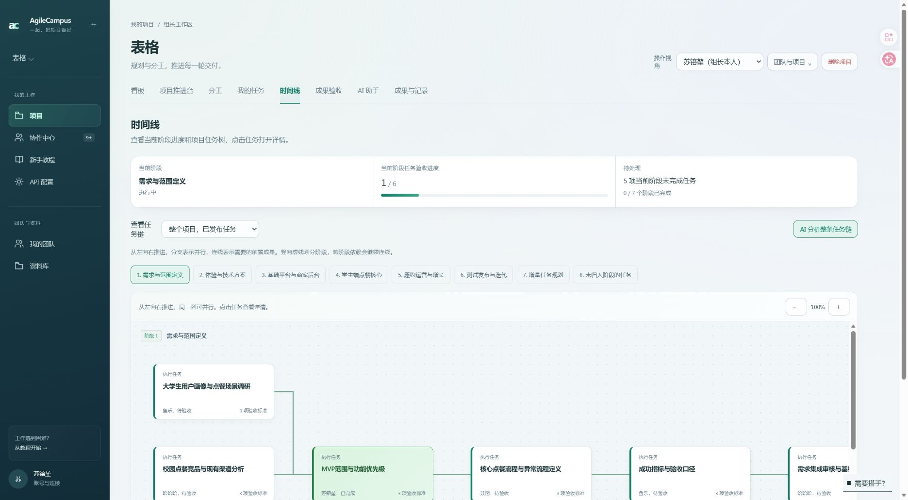

# 任务链动画与时间线修复

- 时间线“AI 分析整条任务链”和草案“AI 重新安排与复核”只播放原有前端进度动画，约 1.8 秒后结束，可手动停止；不请求模型、不写缓存、不修改任务或连线。两处页面加载时不再自动分析。新增任务的独立 AI 完善功能保持原样。
- 动画期间任务树持续显示，取消旧的分析失败提示和反复分析要求。
- 新增阶段时，已有阶段的有效草案连线继续恢复；未覆盖阶段保留项目已登记关系，不推断新的执行依赖。
- 多层分组从父到子向右排列，切换阶段时同时返回树顶部，树内滚动不传递到外层页面，切换任务链时重置旧视口。
- 10 项布局与映射测试通过；修改文件 ESLint、文案检查和生产构建通过。未执行全量数据库测试。
- 实际表格项目验证：已有 65 条连线在动画前、期间、结束后保持不变，任务树始终可见，按钮结束后恢复可用；阶段 2 定位和聂翔任务详情正常打开。无任务状态写入。

