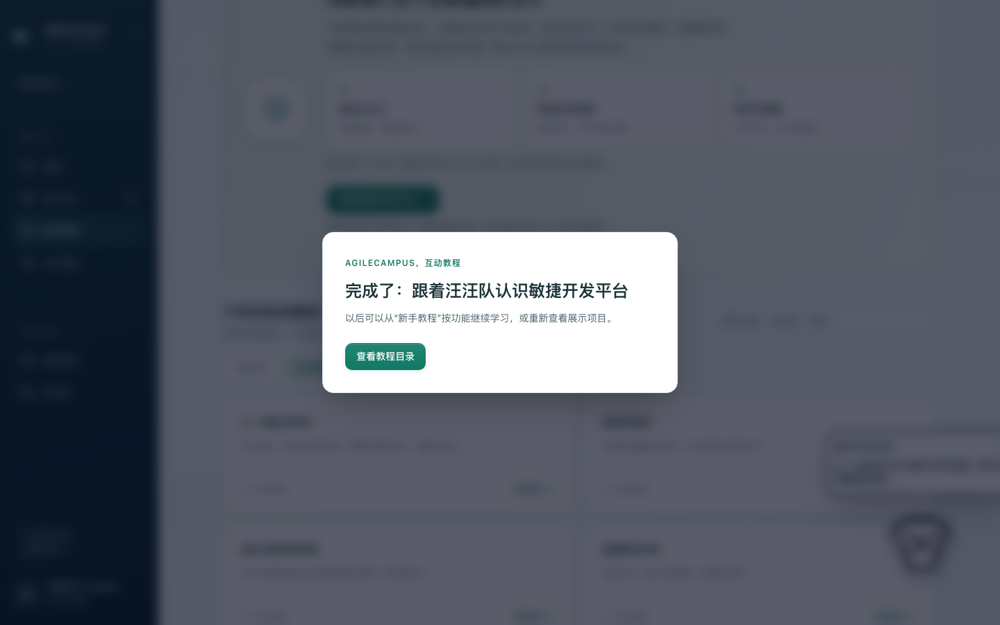

# 安全加固与新手教程全过程检查（2026-11-23）

## 本轮范围

用户要求继续推进两件事：完善 2026-11-18 安全扫描发现的问题，并检查新手教程全过程。本文只记录本轮实际完成的修改、验证证据和仍未覆盖的边界。

## 安全修改

### 1. 模型地址 SSRF

- 新增 `src/lib/url-safety.ts`：保存配置时拒绝本机、私有网络、链路本地、组播、保留地址、云元数据地址和单标签内网主机名。
- 模型请求使用 `guardedModelFetch`：每次请求前解析域名，拒绝解析到内网的域名，并禁止重定向，避免 302 跳到内网。
- 个人模型与站点默认模型都接入该 fetch。
- 需要连接内网自建模型时，必须显式设置 `MODEL_ALLOW_PRIVATE_NETWORK=1`；默认关闭。
- 残余风险：域名解析与实际连接之间仍有极短的 DNS 重绑定窗口；禁止重定向和逐请求解析降低了风险，但不宣称完全消除。

### 2. 应用层限流

新增 `src/lib/rate-limit.ts`，使用进程内固定窗口与并发闸门：

| 入口 | 限制 |
| --- | --- |
| 登录（表单，按 IP） | 20 次 / 10 分钟 |
| 登录（凭据接口，按邮箱，成功后清零） | 8 次 / 10 分钟 |
| 注册（按 IP） | 5 次 / 小时 |
| 注册（全站兜底） | 30 次 / 小时 |
| 聊天（按账号） | 30 次 / 分钟，最多 2 个并发 |
| 草案 AI 分析（按账号） | 20 次 / 分钟，最多 2 个并发 |
| 健康度综述（按账号） | 10 次 / 5 分钟，最多 1 个并发 |
| 记忆提炼（按账号） | 10 次 / 10 分钟，最多 1 个并发 |
| 飞书 JSSDK 签名（按 IP） | 60 次 / 分钟 |
| 飞书 OAuth 起点（按 IP） | 20 次 / 10 分钟 |
| 网页桌宠控制/回复（按账号） | 60 次 / 分钟 |

边界：这是单实例限流。多实例部署时每个实例各自计数，需要换成 Redis 或数据库等共享存储；本轮没有把进程内计数描述成分布式限流。

### 3. 请求体上限

新增 `src/lib/http.ts`，先检查 `Content-Length`，再流式累计字节，超限立即中止：

- 扩展接口 JSON 默认 1 MiB；
- Agent 写入接口 256 KiB；
- 聊天 64 KiB，聊天草案落库 128 KiB，草案 AI 分析 256 KiB；
- 记忆提炼 2 MiB；
- 上下文包创建与预览 512 KiB；
- 会话、决策、审批、证据等其余写入接口 256 KiB，通知回执 4 KiB；
- 任务记忆 2 MiB、接续回执 4 KiB，均改为流式读取；
- 家园设置 64 KiB，桌宠选择 16 KiB；
- 网页桌宠控制/回复 32 KiB。

### 4. 飞书 JSSDK 签名接口

该接口在登录页未登录时也会调用，因此不能简单要求登录。改为：

- 只允许为当前请求来源、`AGILECAMPUS_URL` 或 `FEISHU_JSSDK_ALLOWED_ORIGINS` 中的页面签名；
- 生产环境只要配置了 `AGILECAMPUS_URL`，就只认显式来源，不再信任请求 Host 或 `x-forwarded-host`，避免 Host 头伪造；
- 拒绝非 HTTP(S)、带账号密码或第三方的 URL；
- 按 IP 限流。

### 5. 全局安全响应头

`next.config.ts` 为所有响应补上 `X-Content-Type-Options: nosniff`、`Referrer-Policy`、`X-Frame-Options: SAMEORIGIN`、`frame-ancestors 'self'` 和限制摄像头/麦克风/定位的 `Permissions-Policy`。HSTS 仍建议由 HTTPS 反向代理统一设置，避免本机 HTTP 开发被浏览器缓存。

### 6. 依赖升级

- `next` 16.2.10 → 16.4.6
- `eslint-config-next` 16.2.10 → 16.4.6
- `next-auth` 5.0.0-beta.31 → 5.0.0-beta.32
- `zod` 4.4.3 → 4.6.7
- 其余可自动修复的传递依赖已通过 `npm audit fix` 升级。

生产依赖审计已清零。开发依赖仍有 4 个 moderate（`drizzle-kit` 依赖的 `@esbuild-kit/*`），修复需要破坏性升级，本轮未动。

## 新手教程检查

### 已修复

1. **会话表单被连续自动点击关闭。** 教程每 250 ms 重新定位目标。表单打开后如果 React 尚未重绘，第二次自动点击会把表单重新关回去。现在同一控件 1 秒内只自动点击一次，并补了回归测试。
2. **所有登录后页面出现 React 水合错误。** 网页桌宠在 `useState` 初始化阶段直接读取 `localStorage` 和 `window.innerWidth`，服务端没有桌宠、客户端首帧有桌宠，触发 React #418。改为首帧使用固定默认值，挂载后再读取本地设置和坐标。
3. **教程第 5 步永远定位不到看板。** 看板在默认关闭的 `<dialog>` 里，目标尺寸为 0。现在教程指向黑板触发器，并改为“点击黑板打开看板”的 click 步骤。

### 已核对

- 教程引用的 75 个步骤目标都能在源码中找到对应 `data-tour` 属性；
- 5 个 `completion` 完成标记都能在组件中找到；
- 教程涉及的路由都存在；
- 使用测试库和演示组长账号登录后，逐个请求了欢迎导览的实际页面：
  `/tutorials`、团队成员、项目首页、工作任务台、任务详情（含“当前工作记忆”）、时间线、成果验收、阶段集成、导师视角、项目推进台、AI 对话、成果记录、活动记录；页面均返回 200，欢迎导览所需目标均已渲染；
- 会话表单的 `conversation-toggle`、`conversation-open`、`conversation-closed` 与教程步骤一致；
- 刷新恢复规则覆盖任务弹窗、导师评审、求助面板；会话表单由自动展开逻辑恢复。

### 真实浏览器全过程

使用 Chrome headless + CDP 登录演示组长账号，实际启动欢迎导览，并逐步完成全部 **25 / 25** 步，包括导航、阶段展开、任务详情、时间线、三种视角切换、AI 对话、成果记录、活动记录和“当前工作记忆”步骤。全程控制台错误为 0，最终显示“完成了：跟着汪汪队认识敏捷开发平台”。

## 未覆盖

- 没有逐页检查窄屏/移动端布局；
- 没有分别以组员和老师身份完整走一遍 25 步导览；
- 真实双机 Extension Host 接班仍未实测。

## 验证结果

- `npm test`：105 个文件通过、1 个跳过；951 项通过、2 项跳过。
- `npx tsc --noEmit`：通过。
- `npm run lint`：0 错误，37 条既有警告。
- `npm run build`：通过。
- `npm audit --omit=dev`：0 个生产依赖漏洞。
- VS Code 扩展：37 个文件、214 项测试通过。
- 本地生产构建使用测试库启动，演示组长账号登录成功；上述教程页面逐一返回 200。
- 浏览器认证页面（教程、项目列表、项目首页、时间线）水合错误从每页 1–3 个降为 0。
- Chrome 实际完成欢迎导览 25/25 步，控制台错误 0。
- 安全头的实际 HTTP 响应包含 `nosniff`、`strict-origin-when-cross-origin`、`SAMEORIGIN`、`frame-ancestors 'self'` 和最小权限策略。
- 实测超大请求体：通知 4 KiB、聊天 64 KiB、草案 256 KiB、上下文包 512 KiB 均返回 413；飞书签名第三方来源返回 403，同一 IP 第 61 次请求返回 429。验证服务随后已停止，测试库数据由下一次测试重置。

## 需要保留的本机文件

`scripts/seed-tianyuan-showcase.mjs`、`docs/superpowers/plans/2026-10-25-task-iteration-memory-plan.md` 和旧版 VSIX 仍为未跟踪文件，本轮未修改或删除。
