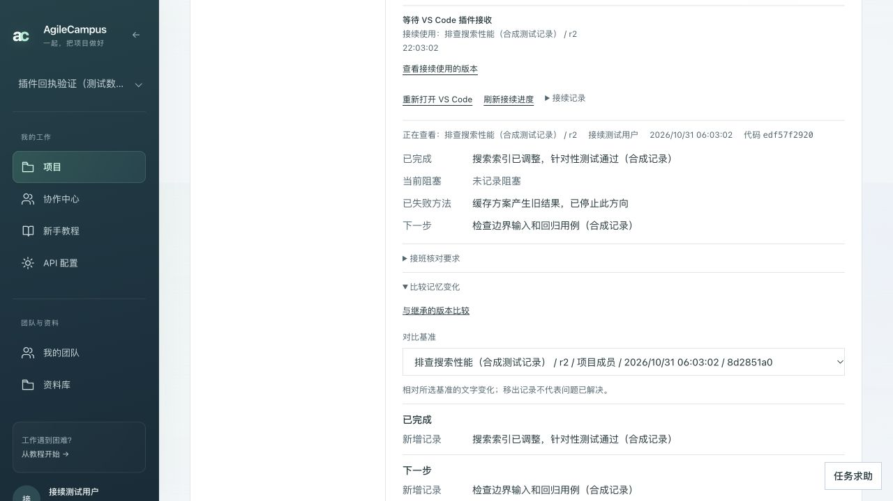

# 工作记忆与 Agent 接续：模块验收版 0.1.8

## 交付目标

成员交接开发任务时，接收者能拿到确定版本的工作记忆，知道之前完成了什么、为什么失败、还有哪些结论需要验证。Agent 在此基础上继续工作，新的执行记录能被整理为下一份断点，保留继承关系。

本模块交付的是可共享的显式工作上下文。底层模型隐藏状态、正在运行的进程和未提交代码由各自工具管理，不等同于恢复原生 session。

## 已形成的工作流程

1. **采集**：插件把任务与本机会话绑定。外部 Codex 会话沿用已有 Hook；插件自己启动的接续 CLI 直接记录继承事件、命令、对应结果、退出码和最终回复。
2. **整理**：脱敏并展示实际出站输入，经确认后调用已配置模型提炼统一结构。区分工具执行证据、作者说明与推测，保留失败条件及来源 ID。
3. **审核**：查看本轮迭代报告与具体出处，人工修订、删除、补充后接受。接受版本不可原地覆盖。
4. **共享**：仅把已确认的记忆保存到对应项目任务。其他成员凭现有权限读取，原始本机会话不会随这个动作自动上传。
5. **接续**：接收端选择固定版本，核对账号、任务、仓库和 Git 基线；确认后启动新 CLI 会话，记录实际继承的版本与来源。
6. **迭代**：结束后按本次 attempt 定位准确会话，整理下一份断点，记录精确父版本。旧记录保持不变；不同尝试各自记录，不自动合并方案。

## 本轮交付修复

- CLI 命令与结果直接写入对应子会话，不再只保存最终说明。测试失败退出码仍是失败证据，Agent 会话结束不代表任务验收。
- 网页指定历史版本暂缺时精确读取；未取得前不使用最新版兜底。父版本即使不在最近 50 条中，也能按 ID、修订与摘要读取。
- 已记录回执断网后持久化补传。损坏文件隔离保留，其余可读记录继续处理；切换账号不能替旧账号发送回执。

## 演示准备

1. 启动与插件同版本的网页服务，按 README 完成数据库 schema 与两份记忆迁移。
2. 在 VS Code 通过“从 VSIX 安装”安装 `vscode-extension/agilecampus-memory-delivery-0.1.8.vsix`，连接服务、项目与工作区。网页和插件使用同一授权账号。
3. Codex CLI 需为已验证的 `0.153.4`，完成 CLI 本身的模型认证。提炼使用平台中当前用户配置的模型；两者配置独立。
4. 选一个测试任务，准备已有提交且干净的 Git 工作区。代码基线不同会阻止启动，应核对差异并准备适用的新断点；本模块不自动处理 worktree 或合并。

## 约 3 分钟的模块演示

| 操作 | 展示的能力 | 应看到的结果 |
| --- | --- | --- |
| 网页进入项目，选择任务，打开“当前工作记忆” | 记忆跟随任务 | 完成项、失败方法、下一步及固定版本 |
| 点击“在 VS Code 继续工作” | 从网页交给开发现场 | 插件核对预览；此时还未启动 |
| 在插件确认启动 | Agent 继承可共享上下文 | 网页收到真实启动回执；会话先核对继承来源 |
| Agent 执行一个小的读取或测试操作并结束 | 执行过程留有证据 | 本机记录命令、结果、退出码；网页显示会话已结束、成果待核对 |
| 点击“整理本次会话为新断点” | 迭代闭环 | 定位准确会话，提炼并展示迭代结果，人工接受后同步新版本 |
| 查看新版本的继承来源并比较 | 版本可追溯 | 精确父版本与新增/移出记录；原版仍可读取 |

演示前先完成一次模型连通与小任务试跑，避免现场等待首次安装或模型认证。若网络不稳定，可展示真实 CLI 验证记录与自动化报告，并明确这些证据分别覆盖的范围。

## 可复现验证

根项目测试使用独立的 `.env.test` 数据库，测试会清理测试数据，不能指向演示库。按仓库原有环境安装依赖后运行：

```bash
npm test
npm run lint
npm run build
cd vscode-extension
npm test
npm run compile
```

真实 CLI 探针在仓库根目录运行：

```bash
npx tsx scripts/smoke-memory-real-cli.ts
```

这会调用一次当前已认证的 Codex CLI，在临时目录创建合成来源仓库和独立接收目录；只要求读取合成文件。使用已配置模型，会产生对应调用用量。结果仅输出状态、计数和校验标志，原始会话保留在临时私有存储。

## 验证证据与边界

本次全量回归：主项目 91 个测试文件通过、1 个文件跳过；822 项通过、2 项跳过。插件 37 个文件、213 项全部通过。生产构建、插件编译及打包通过；全仓 lint 为 0 错误、37 条既有警告。

浏览器使用独立测试库和合成账号，建立超过 50 个历史修订：已验证父版本自动取回、与精确父版本比较、点击旧版本后显示旧内容。证据如下，截图中的完成项及测试说明均为合成数据：



真实 CLI 结果：[结构化验证记录](release-evidence/2026-10-30-real-cli.json)。已观察到真实 session、1 对命令/结果、包含精确记忆 ID 的回复；来源和接收目录、原始记忆均未改变。

真实 CLI 探针不调用网页模型提炼 API，也不替代人工审核。服务器模型提炼、鉴权、来源校验、断网重放和版本读取由自动化测试分别验证。两个物理设备、真实 VS Code Extension Host 的完整交接尚未实测，不能把以上证据描述为已完成这项测试。

## 对老师的说明

“我们负责的是多人使用 Agent 时的开发记忆交接。成员留下经过审核的断点，接收者的 Agent 能继承指定版本，并核对历史结论。工作结束后，新断点保留父版本和执行证据，下一位成员可以继续。负责人仍决定任务分配、方案选择和验收。”

这是课程原型的模块交付范围。worktree、账号与角色、任务流转和全站视觉由其他模块负责，本轮未接管。
